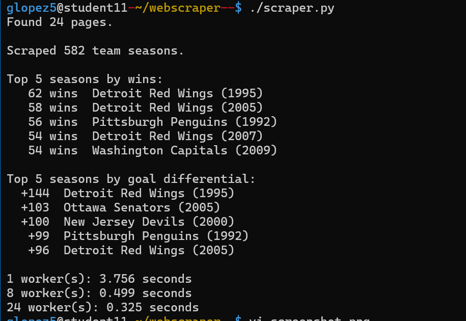

# webscraper

Scrapes [Scrape This Site's Hockey Teams](https://www.scrapethissite.com/pages/forms/) table, which is spread across paginated HTML pages. It reads the pagination links on page 1 to find how many pages there are, fetches every page concurrently, parses each team-season row (name, year, wins, losses, goals for/against), then prints the top 5 seasons by wins and by goal differential.

## How to use

```
pip install requests or python3 -m pip install requests
chmod +x scraper.py
./scraper.py
```

The scraper runs 3 times with 1, 8, and 24 workers, prints how long each run took, then lists the results.

## Real output



## Performance impacts

These results scrape all 24 pages found by the scraper (582 team seasons).

| workers | seconds | 
|---------|---------|
| 1       | 3.756   |
| 8       | 0.499   | 
| 24      | 0.325   |

**concurrent.futures:**  Most of the time is spent waiting, so the threads of the waits overlap. At higher worker counts the increase in speed plateau due to the bandwith and the server's response time.

**functional programming:** parse() and scrape() don’t share any state, so executor.map() can safely run scrape() in parallel. I also used map(), chain.from_iterable, and sorted() with lambda keys. Functional style doesn’t add speed by itself, but it makes the parallel version safe.
